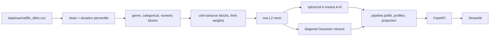

# Netflix content segmentation

Unsupervised segmentation of the Netflix catalogue into named segments. The product model is spherical k-means on a weighted mix of genres, categories, and numeric features. There is no synopsis in this extract, and a titles-only text block did not earn a place in the model. Every number below is written by a script in this repository: `scripts/profile_data.py`, `scripts/design_representation.py`, `scripts/select_k.py`, `scripts/train.py`, and `scripts/evaluate.py`.

**Public deployment:** not published. This environment has no Hugging Face token (and no other host credential), so there is no live URL to put here. Local API: `http://127.0.0.1:8000`. Local UI: `http://127.0.0.1:8501`. Steps for a public host are in `deploy/HUGGINGFACE.md`.

The segment map is the first tab of the UI. t-SNE and UMAP coordinates are precomputed. Distances and gaps on that map are not interpretable; titles were clustered in feature space and the projection was only coloured afterwards.

## How many segments, and why

**k = 6** on representation R1 (genres, categories, numerics; no free text). Mean bootstrap adjusted Rand index is **0.8203 ± 0.1211** (20 resamples, 80% of rows, whole pipeline refit). k=2 is more stable (ARI 0.9996) and was rejected: its labels recover `type` with ARI 0.9953, so that score is the stability of a column the model was allowed to see. The inertia knee is k=9, the best Davies-Bouldin is k=19, and Gaussian-mixture BIC keeps falling through k=20. Those disagreements are in `reports/k_selection.md`. Stability inside the range of segments a person can name decided the product, not the elbow.

| Segment | Titles | Share | What it is |
| --- | --- | --- | --- |
| US Family and Action Films | 1484 | 16.9% | US films led by family (lift 4.89, 36% of the cluster) plus action, horror, and comedy. Mixed, with a real centre. |
| International Drama Films | 2494 | 28.4% | Non-US films. International Movies cover 99% of the cluster; dramas 60%. India is the largest country, not a majority. |
| International TV Series | 1378 | 15.7% | Series outside the US bucket. International TV Shows cover 98%. |
| US Independent Dramas | 932 | 10.6% | US films that are all tagged Dramas; independent films are 36% (lift 4.24). |
| US Kids and Docuseries | 1278 | 14.5% | Non-international series. Kids' TV is the highest lift (35% of the cluster) and docuseries are 22%. Mixed, with a real centre. |
| US Docs and Stand-Up | 1224 | 13.9% | US films. Documentaries cover 67%; stand-up covers 27% at the highest lift. |

No cluster was left unnamed. Clusters 0 and 4 are mixed bags with a distinctive centre, not clean shelves. None is under 2% of the catalogue.

## Validation

Scores for the product spherical k-means, from `scripts/select_k.py` and `scripts/evaluate.py`.

| Metric | Value |
| --- | --- |
| Silhouette | 0.1282 |
| Calinski-Harabasz | 872.8254 |
| Davies-Bouldin | 2.5171 |
| Bootstrap ARI (mean ± std) | 0.8203 ± 0.1211 |
| Seed-to-seed ARI at k=6 | 0.8082 |
| Held-out `type` ARI / NMI | 0.2632 / 0.4271 |
| Held-out `rating` ARI / NMI | 0.0665 / 0.1165 |
| Held-out primary genre ARI / NMI | 0.1963 / 0.3474 |

The external scores come from a second fit that never sees `type`, `rating`, or the primary genre. Secondary genres stay visible, so primary-genre agreement is partly co-occurrence. Type and rating are the cleaner checks. Modest silhouette is normal for overlapping genres; it was not tuned upward. Heatmaps: `reports/figures/contingency_type.png`, `contingency_rating.png`, `contingency_primary_genre.png`.

## Architecture



`/assign` calls the saved pipeline. It does not refit.

## Quickstart

Python 3.11. Put the catalogue at `data/raw/netflix_titles.csv` (this repo already has the extract exported from `Dataset.csv.xlsx`).

```bash
python -m venv .venv
.venv/bin/python -m pip install -r requirements-dev.txt   # Windows: .venv\Scripts\python.exe
make profile
make design-rep
make select-k
make train
make evaluate
make test
make run
```

`make run` serves the API on port 8000 and the UI on port 8501. The UI talks to `API_BASE_URL` and does not import the model.

Docker, after `make train` so `models/` exists (those artifacts are gitignored and are copied into the image at build time):

```bash
docker compose up --build
```

A clone with no trained `models/` directory cannot build a working image. CI trains the 120-row fixture before `docker build`, which checks the image, not the full catalogue. UMAP is installed for training only. The runtime image does not include `umap-learn` or HDBSCAN; the UI reads `models/projection_2d.parquet`.

## Project structure

`src/data` cleans and validates. `src/features` builds the weighted blocks and the duration percentile. `src/models` selects k, measures bootstrap stability, and persists one `SegmentationModel`. `src/interpret` names clusters from genre lift and c-TF-IDF. `src/api` is the HTTP service. `app/streamlit_app.py` is the UI. `reports/` is the evidence. `docs/DECISIONS.md` records the modelling choices.

## Representation

Distance-based clustering is only as good as the distance. Three representations were fit and scored (`reports/representation_design.md`):

| Representation | Shape at the candidate k | Bootstrap ARI | Silhouette |
| --- | --- | --- | --- |
| R1 genre + numeric + categorical | 8790×107 | 0.7248 at k=9 | 0.1451 |
| R2 SVD(title, 150) + R1 blocks | 8790×257 | 0.7323 at k=9 | 0.0796 |
| R3 title text only | 8790×150 | 0.5181 at k=5 | 0.2626 |

R2's stability lead over R1 is 0.007, under the 0.05 margin required before the text block is allowed in. R3 has a prettier silhouette and worse stability. **R1 is the product.** The comparison k above is the inertia knee, not the product k. The product k is 6, chosen later on R1. The 107 columns in that table include `description_word_count`, which is 0 on every row of this extract. It was removed before the serving fit. The saved matrix is 8790×106 and the cluster labels match the 107-column fit exactly, so the validation tables did not move.

Blocks are scaled to unit total variance, multiplied by `sqrt(weight)`, concatenated, then L2-normalised per row. Default weights are text 1.0, genre 1.0, categorical 0.5, numeric 0.5. A raw stack of a 20,000-column TF-IDF block on eight numeric columns is not used. Text, when it is used, goes through `TruncatedSVD` and a second normaliser, not PCA. One-hot countries are equidistant; that geometry is arbitrary, so the categorical block is down-weighted. Gower distance (float32, 3,000-row subsample, silhouette 0.1128) and KPrototypes (2,000-row subsample) are comparisons, not the serving model.

Duration is a within-type percentile (`duration_normalised`). Median-imputing both minutes and seasons would hand every film the median season count. That alternative is rejected in `docs/DECISIONS.md`.

`description_word_count` is 0 for every training row because the extract has no synopsis. It is not a model feature. Leaving it in would flag every described title as an outlier on a column the catalogue never varies.

## Algorithms

Compared on the product matrix in `reports/algorithm_comparison.md`. Spherical k-means is the product. MiniBatch k-means is faster here and not better enough to replace it; at 8,790 rows the full fit is already cheap. Ward linkage and average-linkage cosine (the latter on a fixed 4,000-row subsample, because a full cosine matrix is large) supply dendrograms. A diagonal Gaussian mixture supplies membership probabilities. DBSCAN with eps taken from the k-distance knee found **1 cluster and a noise fraction of 0.0015**. Density clustering collapses on this sphere; that negative result is the finding. Bisecting k-means is a sixth check.

## API

`docs/API.md` has a curl example and the response captured from a running server for each route. Interactive docs: `http://127.0.0.1:8000/docs`.

## Tests and CI

`pytest` on this machine: 44 passed, coverage **85.80%** (`--cov-fail-under=80`). `ruff check`, `black --check`, and `mypy src` pass. The fixture has three planted groups; the recovery test requires adjusted Rand index above 0.6 at k=3. Two seeded fits must return identical labels. GitHub Actions (`.github/workflows/ci.yml`) runs the same gates and a Docker build on push and pull request to `main`. The badge below tracks that workflow once the branch is pushed. It is not a claim that a remote run has already gone green.

[](https://github.com/ThevinduFernando2003/Netflix-Content-Segmentation/actions/workflows/ci.yml)

## Limitations and next steps

There is no ground truth. Held-out type and rating are association, not accuracy. Results move with the metric, the weights, and k. High-dimensional distances concentrate; spherical k-means and the decision to drop raw TF-IDF reduce that, and they do not remove it. One-hot countries are an arbitrary geometry. t-SNE and UMAP do not preserve global distance or cluster size. The catalogue is one snapshot, English-centric where text is used, and it has no synopsis and no cast. Clusters 0 and 4 are mixed. The diagonal Gaussian mixture is a separate fit from k-means, so a membership bar can peak on a different segment from the assigned id. Night Docket does this; the captured response is in `docs/API.md`.

Next: sentence-transformer embeddings if a real synopsis is available; HDBSCAN on a UMAP embedding rather than DBSCAN in the feature space; a two-level segmentation that splits the two mixed clusters; incremental assignment when titles are added to the catalogue without a full refit.

## Environment

See `.env.example`. No secrets belong in the repo.

| Variable | Role |
| --- | --- |
| `API_BASE_URL` | Where the UI sends HTTP requests |
| `PORT` | API port |
| `CORS_ORIGINS` | Comma-separated browser origins |
| `RATE_LIMIT_PER_MINUTE` | In-memory limit; `0` disables it |
| `ARTIFACT_DIR` | Directory with `pipeline.joblib`, profiles, projection |
| `PROJECT_ROOT` | Directory that contains `config.yaml` |
